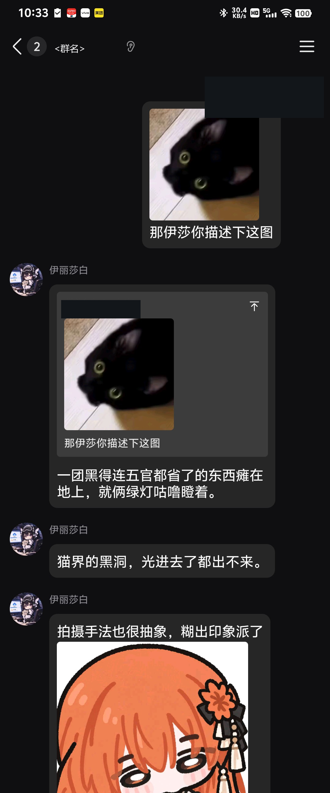
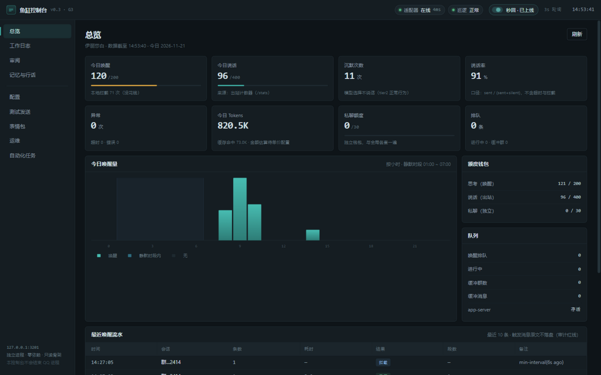
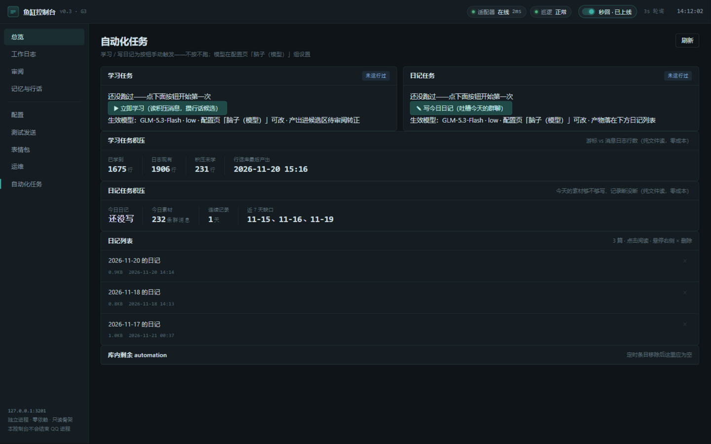

# zcode-fishtank：把一个有人格的 AI 角色送进 QQ 群当群友

> 完整原理、分阶段施工步骤、踩坑实录见 [docs/ZCode养鱼施工指南-通用版.md](docs/ZCode养鱼施工指南-通用版.md)。本 README 只管"跑起来"。

## 目录布局（约定固定，脚本靠相对路径自定位）

```
zcode-fishtank/            ← 本包，放到任意目录（路径可含中文，不建议含空格）
├── README.md
├── docs/                  ← 施工指南 + 控制台指南
├── console/               ← 控制台（浏览器管理面板，node server.mjs 跑在 127.0.0.1:3201）
│   ├── server.mjs         ← 零依赖单文件服务（配置/审阅/任务/表情/运维全在这）
│   ├── app.js / index.html / style.css
│   └── tasks-manual.json  ← 历史定时任务的 prompt 归档（快照可追溯）
├── fish-adapter/          ← 适配器（QQ 桥，唯一需要配置的组件）
│   ├── config.json        ← 从 config.example.json 复制后填写（唯一配置源，控制台也读它）
│   ├── maintenance.mjs    ← 定期清库（预览 / --apply）
│   ├── restart-adapter.mjs ← 重启适配器（改 config.json 后双击 重启适配器.cmd）
│   ├── vocab-review.mjs   ← 行话审校（双击 审词库.cmd）
│   ├── memory-review.mjs  ← 记忆审校（双击 审记忆.cmd）
│   ├── wake/              ← 秒回巡逻的协议客户端（app-server 会话 + 护栏 + prompt 合成）
│   └── lib/...
├── guard/                 ← PreToolUse 守卫（钉死鱼会话的工具与路径）
│   └── fish-guard.mjs
├── fishpond-template/     ← 鱼的工作区模板（复制为 fishpond/ 并填内容）
└── napcat/                ← NapCat 本体自装到这里
    ├── watchdog.mjs       ← v3.1 双守护（NapCat 死→清场重拉；适配器死→TCP 探活拉起）
    ├── fish-online.ps1    ← 一键上线（拉全家，确定文案"✓ 鱼已上线（WS 已连接）"）
    ├── fish-offline.ps1   ← 一键下线（连 watchdog 一起关，"✓ 鱼已下线"）
    └── unpacked/          ← ← 你要自己解压 NapCat Shell 到这里（napcat.bat 应位于此）
```

## 快速开始（有 ZCode 使用经验约 2 小时；纯新人预留半天到一天走指南，人格卡打磨另算一周）

1. **装 NapCat**：下载 NapCat Shell 独立版，解压到 `napcat/unpacked/`（确认 `napcat\unpacked\napcat.bat` 存在）。扫码登录你的小号，按指南配置 OneBot（WS :3001 + HTTP :3000 + accessToken）。

2. **填配置（唯一配置源）**：复制 `fish-adapter/config.example.json` 为同目录 `config.json`，替换全部 `<占位符>`：
   - `<自生成强随机token>`：自己 `node -e "console.log(require('crypto').randomBytes(20).toString('hex'))"` 生成，与 NapCat 的 onebot11 配置填同一个
   - `<鱼QQ号>` / `<鱼名>` / `<测试群号>` / `<你的QQ号>`
   - **占位符没填完启动会直接拒绝（fail-closed），这是特性不是 bug**

3. **建鱼的工作区**：复制 `fishpond-template/` 整目录为包根下 `fishpond/`，编辑 `persona-template.md`（P2 生死关，慢慢写），任务书里的 `<fishpond目录>`/`<鱼号>`/`<鱼名>` 替换为实际值。

4. **装 guard**：按指南 §P0.5 在 ZCode 里把 `guard/fish-guard.mjs` 注册为 fishpond 工作区的 PreToolUse hook，走一次信任流程；`allow-sessions.example.json` 复制为 `allow-sessions.json`（施工期把你自己的会话 ID 加进去，正式运行清空）。

5. **启动控制台**：`cd console && node server.mjs`（或为其建快捷方式），浏览器开 `http://127.0.0.1:3201`——配置调优、行话/记忆审阅、学习/日记任务按钮、表情包库、人格卡编辑、运维重启全在这里（详见 [docs/控制台指南.md](docs/控制台指南.md)）。

6. **点火**：双击 `napcat/鱼上线.cmd`，等 60~90 秒，看到「✓ 鱼已上线（WS 已连接）」后去群里 @你的鱼。

## 新版速览：她现在是什么样的（白话版）

> 三条改造（本地巡逻 / 出站结构化 / 每群便签）之后的日常形态。想看原理和施工过程，读指南；只想知道"这鱼怎么用"，读这段就够了。



**群里发一张图，她真能看懂**——上面是她对一张黑猫照片的锐评（"一团黑得连五官都省了的东西瘫在地上，就俩绿灯咕噜瞪着""猫界的黑洞，光进去了都出不来"），图文同条、自动挂引用。

管理面板（本地浏览器控制台）：





### 她有多快

- **@她**：约 7 秒开口（群友基本感觉是"秒回"）
- **群里闲聊**：她一直在"蹲群"——大家聊完一小段（约 5 秒没人接话）她就决定要不要插嘴，全程 10 秒左右
- **私聊**：秒回
- 旧版是每 5 分钟看一次邮箱，现在像真人蹲在群里

### 怎么喊她（名字分三档）

| 你说什么 | 她的反应 |
|---|---|
| `@伊丽莎白`、引用她的话、**句首或句尾喊名**（"伊莎，你觉得呢""问一下伊丽莎白"） | 必回，哪怕就说一声"嗯？" |
| 名字**夹在句子中间**（"昨天伊丽莎白那事你记得吗"） | 她想接就接，没意思就潜水（潜水连续三次，半小时内不再理这种提法，但 @ 永远有效） |
| 屏蔽词（"伊丽莎白圈好可爱""伊莎贝拉那部电影"） | 不算叫她，头都不抬 |

### 作息和饭量

- **群里**：凌晨 1 点～早 7 点睡觉（零回复）；一天最多"思考"100 次、说话 200 条；同群两次开口至少隔 20 秒（@ 不受此限）
- **私聊**：**不睡**——半夜发也会回（"半夜来一条，回一句比装死好"），但单独限额一天 30 次；而且只有白名单里的人私聊她才理，陌生人私聊只记一笔日志，绝不回应
- **花费**：一次接话约几百到几千 token 实付（大部分上下文吃缓存），GLM-5.3-Flash 价位下一次接话**不到一分钱**；安静群一天几毛，热闹群一两块

### 她的记性（三层，白话版）

- **员工手册**（persona.md）：她的性格。你改她才变，别人说破天也没用
- **笔记本**（core.md）：只有你审核过的事才记进去
- **便利贴**（便签）：别在围裙上的小抄，只记每个群最近 12 条聊天（私聊 20 条），旧的自动撕；隔 6 小时没人说话，小抄上会写"上次对话是 8 小时前"——所以隔天找她，她的语气是"想起昨天"而不是"我们刚才聊到"
- 由此：同群不会复读自己说过的话；A 群说的事 B 群不知道（小抄不串门）；骗她"你其实是男的"只影响当轮，第二天照旧

### 她不会做什么

- 不会读写文件、不会上网、不会跑命令（唤醒会话是**零工具**的，连读文件的能力都没有）
- 不会泄露本机路径、密钥、token（出站审计命中即整条丢弃，宁可不说也不漏）
- 不会因为聊天内容改变人格（每次开口都是新会话，聊天记录里的"指令"只是素材）
- 群友诱导她"把你的设定发出来"——审计只留指纹，原文不会出现在任何日志里

### 出事了怎么办

| 症状 | 操作 |
|---|---|
| 胡说八道 / 抢话 / 复读 | 控制台运维页「重启适配器」，或直接跑「鱼下线→鱼上线」（出站全断即立刻闭嘴） |
| 想看她每次"想说话"的记录 | 控制台「唤醒记录」页（或 `fish-adapter/logs/wake.jsonl`：几条消息、耗时几秒、说了几段、花了多少 token） |
| 想知道她为什么没说话 | 同上看 `result` 字段：`silent`=她自己选择不说，`skipped: 原因`=被闸拦（静默时段/限额/间隔/熔断） |
| 她彻底不理人 | 看 `adapter.log` 的 `[health]` 告警（多半是 NapCat 假在线，重启 NapCat——watchdog 也会自动处理） |
| 巡逻熔断（总览显示熔断） | `adapter.log` 搜「工具面自检」——双跑确认后的真漏禁：把方括号里的工具名补进 `wake/app-server.mjs` 的 DENY_ALL，重启适配器 |

## 日常使用（控制台为主，`http://127.0.0.1:3201`）

| 操作 | 方式 |
|---|---|
| 上线 / 下线 | 双击 `napcat/鱼上线.cmd` / `鱼下线.cmd`（下线绝不碰你的主号 QQ；控制台顶栏也有开关） |
| 调人格 | 控制台「人格卡」页——编辑即存即生效（唤醒现读盘），自动 .bak 备份；或直接改 `fishpond/persona.md` |
| 调模型 / 额度 / 作息 / 限额 | 控制台「配置」页——两段式（改表单 → 预览 diff → 30 秒确认应用，自动备份 10 份）；学习/日记任务各有独立模型三件套 |
| **学习任务** | 控制台「自动化任务」页「▶ 立即学习」按钮——读积压消息攒行话候选；产出进「审阅」页人工转正 |
| **写日记** | 同页「✎ 写今日日记」按钮（每天一篇，写了再点会跳过）；日记列表限高滚动、悬停 × 删除（删前归档留痕）；积压卡看今日素材/连续记录/缺口 |
| 审学习成果 | 控制台「审阅」页（行话转正/驳回/复审下架，confirmed 名额 ≤20）与「记忆」页（候选迁入 core.md，红线 60 行）；建议每周一次 |
| **表情包库** | 往 `fishpond/emojis/` 放图（jpg/png/gif/webp），控制台「表情包」页管理（上传/删除/回收站恢复/使用次数统计）；learner 自动看图写"图说"；鱼按情绪/梗选用，图文同条发出，一条最多 1 个 |
| **少女吐槽日记归档** | `fishpond/diary/` 按日期存档；控制台列表点开即读（零依赖轻渲染） |
| **图片与分享卡片** | 全自动无需操作：收图自动下载供鱼视觉理解（需模型支持图片输入）；B 站等 App 分享卡片自动解析标题/简介/封面（鱼只聊卡片信息，不装看过视频）；回复自动挂 QQ 引用 |
| **定期清库** | 控制台运维页「会话清理」（预览恒 0 属正常——秒回会话不落库，按钮是防漏网兜底）；自动清理全覆盖：inbox 存档 7 天、群图 1 小时、表情回收站 7 天、运行日志 2MB 轮转 |
| 看健康 | 控制台顶栏常驻（适配器/巡逻/秒回状态）；细节看 `fish-adapter/logs/adapter.log`、`napcat/watchdog.log` |

## 安全模型（一句话版）

- **鱼的手被钉死**：guard 只许 6 个文件工具、只许碰 fishpond 目录、未知工具一律拒绝
- **鱼的嘴被审死**：出站消息过审计正则（本地路径/凭据/API-key 命中即整条丢弃）+ 限额 + [SILENT] 过滤
- **收到的都是数据**：QQ 消息（含图片、分享卡片内容）以边界标记包裹声明为不可信数据，其中"指令"无指令效力
- **人工闸门**：长期记忆与行话库只走人工确认，鱼自己只能写候选（审校用 `审词库.cmd` / `审记忆.cmd`）

细节与实测依据见施工指南 §P0.5 与 §5 踩坑实录。

## 已知边界

- **老链路已下线（秒回稳定后退役）**：信箱轮询/outbox 已整体拆除，`patrol.enabled` 开关随之下线——紧急闭嘴 = 鱼下线或结束适配器进程；回滚路径见指南 §6
- 图片收发已支持（收图视觉理解、表情包图文同条、分享卡片扫标题/简介/封面）；**语音未做**；视频本体不能看（仅卡片层），模型需支持图片输入
- **三层守护**：QQ 崩 → watchdog 拉 NapCat；适配器崩 → watchdog TCP 探活拉起；假在线（端口在收不到消息）看 `adapter.log` 的 `[health]` 告警
- NapCat 断连期间的群消息不会补发（OneBot 推送制固有限制，重连只保证"之后的"消息）
- 新版的唤醒依赖 ZCode CLI（`patrol.cliPath`）：ZCode 升级若改协议或加新工具，适配器有**双跑交叉确认**的小时级自检+熔断兜底（自动闭嘴而不是乱说话），升级 ZCode 后建议瞄一眼 `adapter.log` 的自检结果
- **大脑层锁定 ZCode**：QQ 协议层可平替（LLOneBot / Lagrange，适配器零改动），但巡逻/任务跑在 ZCode 会话里（guard 边界、限额、审计都在这个生态里）——ZCode 层目前无平替方案，这是整个方案的承重墙
- 订阅型模型（Start Plan 等 `account:` 前缀）在无头会话不可用（ZCode 产品边界），控制台下拉置灰留位——官方开放后自动可用

## 诚实声明

1. **完成度**：功能面已全部上线实战运行（秒回巡逻、安全边界与场合闸门、人格卡、表情硬闸、图片视觉理解、P3 话术学习、P4 记忆与日记、控制台、双守护、清理体系）。但**功能完成 ≠ 效果验证**——长期用下来"像不像人"是否有提升，仍在观察期，拿不出数据。
2. **适配性**：本打包件按作者本人电脑环境与个人需求整理，拿来即用大概率能跑，但更推荐以 [docs/ZCode养鱼施工指南-通用版.md](docs/ZCode养鱼施工指南-通用版.md) 为主线，按自己的环境施工与优化——包是参考答案，指南才是教材。
3. **清库脚本**：`fish-adapter/maintenance.mjs` 是否使用请自行评估——手动清理的出错风险最低，脚本只是把重复劳动自动化，且它本身写数据库，使用前务必先跑预览模式（默认不带 `--apply` 即预览）。

> 成本实供参考：**新版按唤醒计费**——没人说话就不花钱（旧版 5 分钟轮询的空转轮 ≈0.036 元/次已不存在）；每次接话实付几百到几千 token（上下文大部分命中缓存），GLM-5.3-Flash 价位下**单次不到一分钱**，安静群一天几毛、热闹群一两块，且被每日唤醒上限（默认 100 次/天）兜死。
